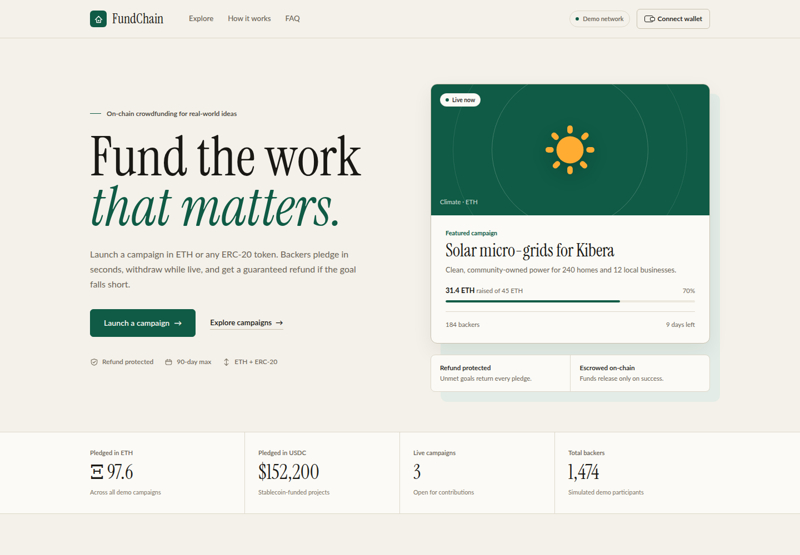
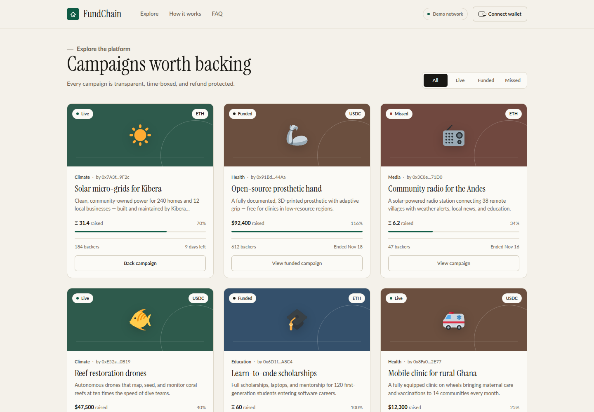
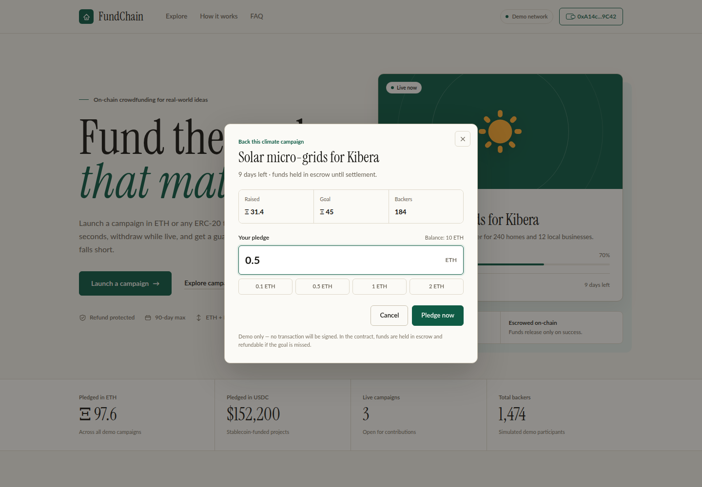
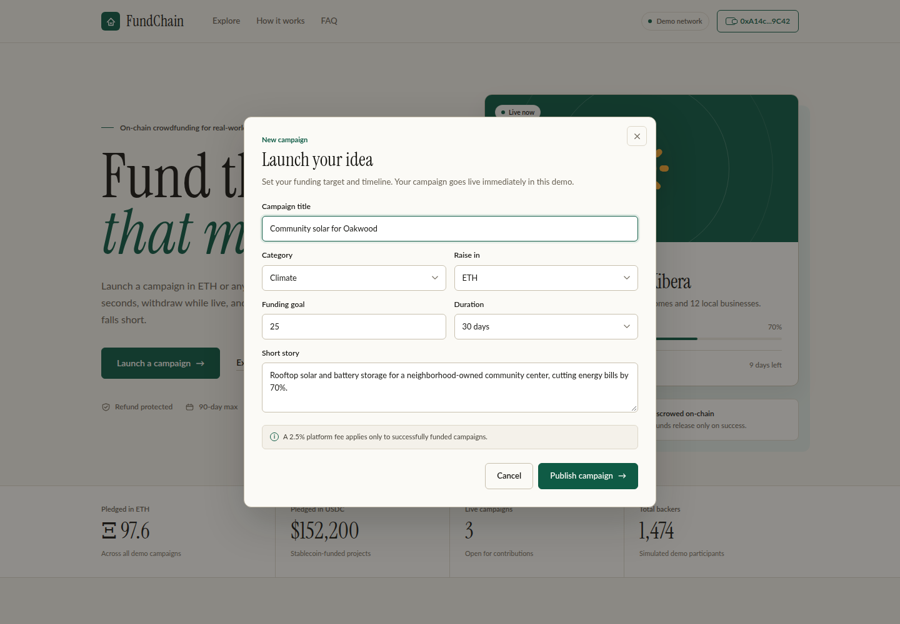
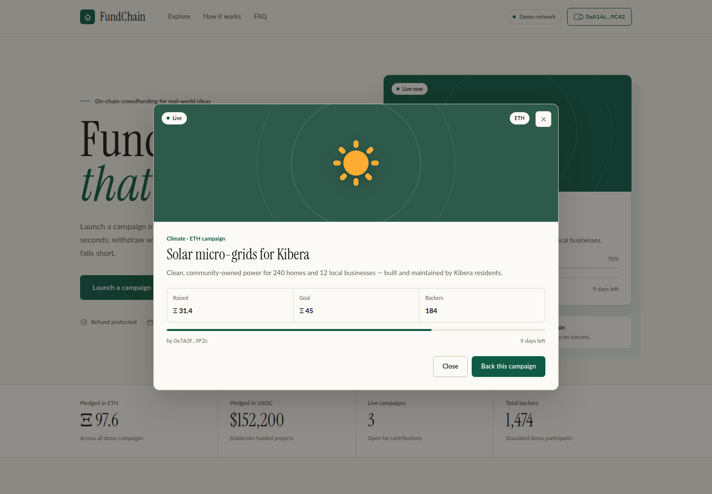

# Decentralized Crowdfunding Platform

A production-oriented Foundry project for launching ETH- or ERC-20-funded crowdfunding
campaigns. Creators define a goal, start time, and deadline (maximum 90 days). Backers
pledge while a campaign is live and may withdraw before the deadline. After the deadline:

- **Goal reached** — the creator claims the funds; an optional platform fee is deducted.
- **Goal missed** — each backer pulls a full refund of their remaining pledge.

The contract is written in Solidity `^0.8.24` and uses OpenZeppelin Contracts for
`Ownable`, `ReentrancyGuard`, `SafeERC20`, and `IERC20`.

## Live Demo

**Try it now → [aryann-4.github.io/crowdfunding-platform](https://aryann-4.github.io/crowdfunding-platform/)**

[](https://aryann-4.github.io/crowdfunding-platform/)

| Explore campaigns | Back a campaign |
| --- | --- |
| [](https://aryann-4.github.io/crowdfunding-platform/#campaigns) | [](https://aryann-4.github.io/crowdfunding-platform/?demo=pledge) |
| **Launch a campaign** | **Campaign details** |
| [](https://aryann-4.github.io/crowdfunding-platform/?demo=launch) | [](https://aryann-4.github.io/crowdfunding-platform/?demo=detail) |

> The hosted demo is an interactive UI with **simulated funds**. It demonstrates the
> campaign, pledge, unpledge, launch, and refund flows enforced by the Solidity contract.

## Repository Layout

```
crowdfunding-platform/
├── src/
│   └── CrowdfundingPlatform.sol      # Core platform contract
├── test/
│   ├── CrowdfundingPlatform.t.sol    # Unit, edge-case, security, and fuzz tests
│   └── mocks/
│       └── MockERC20.sol             # Mintable ERC-20 used by tests
├── script/
│   └── Deploy.s.sol                  # Environment-driven deployment script
├── docs/                             # Static demo dApp (GitHub Pages)
│   ├── index.html
│   ├── styles.css
│   ├── app.js
│   ├── assets/
│   │   ├── emoji/
│   │   └── fonts/
│   └── screenshots/
├── .github/workflows/test.yml        # CI: fmt, build sizes, full test suite
├── foundry.toml
├── remappings.txt
├── Makefile                           # install/build/test/deploy shortcuts
├── .env.example
├── LICENSE
└── README.md
```

## Setup

### Prerequisites

- [Foundry](https://book.getfoundry.sh/getting-started/installation)

```bash
curl -L https://foundry.paradigm.xyz | bash
foundryup
```

### Install dependencies

```bash
git clone <repository-url>
cd crowdfunding-platform
make install
```

`lib/` is intentionally not committed. `make install` installs the pinned versions:

- `forge-std` v1.9.6
- `OpenZeppelin/openzeppelin-contracts` v5.1.0

Equivalent direct commands:

```bash
forge install foundry-rs/forge-std@v1.9.6 --no-git
forge install OpenZeppelin/openzeppelin-contracts@v5.1.0 --no-git
```

## Build and Test

Using the `Makefile`:

```bash
make install    # install pinned dependencies after cloning
make build
make test
make test-v     # verbose traces
make gas        # gas report
make snapshot   # gas snapshot
```

Or call Foundry directly:

```bash
forge build
forge test
forge test -vvv                 # verbose traces
forge test --match-test Claim   # run a subset
forge test --gas-report         # gas snapshots
FOUNDRY_PROFILE=ci forge test   # 1,000 fuzz runs per fuzz test
```

GitHub Actions runs formatting, compilation with contract sizes, and the full CI test
profile on every push and pull request.

The suite covers:

- Campaign creation for ETH and ERC-20, including all timestamp/goal/token validation.
- Pledging, partial/full unpledging, overfunding, and every active-window boundary.
- Successful claims with and without platform fees for both asset types.
- Failed-campaign refunds, multiple backers, and refunds after partial withdrawal.
- Reverts for non-creators, early claims, missed goals, double claims, double refunds,
  zero-value pledges, ETH sent to ERC-20 campaigns, and unknown campaign IDs.
- Reentrancy simulation through a malicious ETH receiver.
- Fuzz tests for ETH/ERC-20 pledge and refund amounts, plus partial unpledging.

## Interactive Demo dApp

The `docs/` folder contains a dependency-free static demo that mirrors the contract
flows: browse campaigns, filter by status, pledge ETH/USDC, unpledge, launch a
campaign, and claim a refund from a failed campaign. State is stored in
`localStorage`, so the demo can be reset from the footer.

Run it locally:

```bash
make demo
# or: python3 -m http.server 8787 --directory docs
# open http://127.0.0.1:8787/
```

It is deployed automatically from the repository's `docs/` folder via GitHub Pages:
<https://aryann-4.github.io/crowdfunding-platform/>.

The demo intentionally uses simulated balances. It does not sign transactions or
connect to a deployed contract.

## Architecture

### Campaign storage

```solidity
struct Campaign {
    address creator;
    address token;      // address(0) => native ETH
    uint256 goal;
    uint256 pledged;
    uint64 startAt;
    uint64 endAt;
    bool claimed;
    bool canceled;
}
```

Per-backer accounting lives in:

```solidity
mapping(uint256 => mapping(address => uint256)) public pledgedAmount;
```

Campaigns are identified by a monotonically increasing `campaignCount`. A campaign
exists when `id < campaignCount`.

### Lifecycle

```
launch ──► scheduled ──► active ──► ended ──┬── goal reached ──► claim (creator)
             │             │                │
             │             └── unpledge ◄────┘
             │                              └── goal missed ───► refund (each backer)
             └── cancel (creator, before startAt)
```

- Pledging is enabled for `startAt <= block.timestamp <= endAt`.
- Unpledging is enabled for `startAt <= block.timestamp < endAt`.
- Settlement (claim or refund) requires `block.timestamp > endAt`.
- Cancellation is only possible while `block.timestamp < startAt`; no funds can be
  pledged yet, so cancellation needs no refund logic.

### Function flows

#### `launch(token, goal, startAt, endAt)`

1. Reject zero goal, past start, non-increasing end, duration above 90 days, and
   non-contract ERC-20 addresses.
2. Allocate the next campaign ID (`campaignCount++`).
3. Persist the campaign and emit `CampaignLaunched`.

#### `pledge(id, amount)` — payable, `nonReentrant`

1. Load the campaign and require it is not canceled and is inside its active window.
2. **ETH campaign** (`token == address(0)`): require `msg.value > 0` and
   `amount == msg.value`.
3. **ERC-20 campaign**: require `msg.value == 0`, `amount > 0`, then
   `safeTransferFrom(msg.sender, address(this), amount)`.
4. Increase campaign and backer accounting, then emit `Pledged`.

Overfunding is allowed. A campaign succeeds whenever `pledged >= goal`.

#### `unpledge(id, amount)` — `nonReentrant`

1. Require the campaign is active and `amount > 0`.
2. Require the caller's recorded balance is sufficient.
3. Decrement both balances **before** transferring ETH or tokens back.
4. Emit `Unpledged`, then pay out.

#### `claim(id)` — `nonReentrant`

1. Require caller is the creator, the deadline has passed, the goal was reached, and
   the campaign has not been claimed.
2. Set `claimed = true` **before** any transfer.
3. Compute `fee = pledged * platformFeeBps / 10_000`.
4. Pay `pledged - fee` to the creator and `fee` to `feeRecipient`.
5. Emit `Claimed`.

#### `refund(id)` — `nonReentrant`

1. Require the deadline has passed and the goal was missed (`pledged < goal`).
2. Read the caller's balance; require it is non-zero.
3. Clear the backer balance and decrement the campaign total **before** transferring.
4. Emit `Refunded`, then pay out the full remaining pledge.

Refunds are pull-based: each backer claims independently, so one reverting receiver
cannot block other refunds.

## Security Properties

- **Checks-Effects-Interactions** — all accounting is updated before external calls.
- **Reentrancy protection** — every value-moving entry point uses `nonReentrant`.
- **Safe token handling** — `SafeERC20` handles non-standard ERC-20 return values.
- **Safe ETH transfers** — low-level `call{value: ...}` with explicit success checks;
  no `.transfer()` / `.send()` gas assumptions.
- **No direct ETH** — `receive()` and `fallback()` revert, preventing accidental or
  forced accounting mismatches.
- **Custom errors** — gas-efficient, typed failures such as `NotCreator`,
  `CampaignNotActive`, `GoalNotReached`, `GoalAlreadyReached`, `InvalidAmount`, and
  `TransferFailed`.
- **Bounded platform fee** — owner-configurable fee is capped at 500 bps (5%).
- **Checks before state changes** — campaign IDs are validated before use, and
  duplicate claims/refunds are impossible.

### Notes on trust assumptions

- The owner can change the platform fee up to 5% and the fee recipient. Fees apply at
  claim time. Deploy with a fee you are comfortable with, or use a timelock/multisig
  owner in production.
- ERC-20 campaigns inherit the risk profile of the accepted token (fee-on-transfer,
  rebasing, or malicious tokens). Use reputable tokens; the contract credits the
  requested `amount`, so fee-on-transfer tokens may leave the contract undercollateralized.

## Deployment

The `Makefile` loads `.env` automatically, so `make deploy` can use `RPC_URL`,
`PRIVATE_KEY`, and the optional settings directly from that file.

```bash
cp .env.example .env
```

Minimal `.env` for a local dry run:

```dotenv
# Anvil account #0 — public test key, never use for real funds
PRIVATE_KEY=0xac0974bec39a17e36ba4a6b4d238ff944bacb478cbed5efcae784d7bf4f2ff80
RPC_URL=http://127.0.0.1:8545
```

For a testnet or mainnet deployment, use a funded key and a real RPC endpoint.
Never commit `.env`.

`OWNER` defaults to the deployer, `FEE_RECIPIENT` defaults to `OWNER`, and
`PLATFORM_FEE_BPS` defaults to `0`. Empty or zero-address values fall back to those
defaults.

### Local end-to-end deployment

Terminal 1:

```bash
make anvil
```

Terminal 2 (with the Anvil key and RPC URL in `.env`):

```bash
make deploy-dry   # simulate only
make deploy       # broadcast to local Anvil
```

### Testnet deployment

```bash
# .env: set PRIVATE_KEY to a funded testnet key and RPC_URL to the testnet RPC

make deploy-dry
make deploy
```

Equivalent direct Foundry commands:

```bash
forge script script/Deploy.s.sol --rpc-url "$RPC_URL"

forge script script/Deploy.s.sol \
  --rpc-url "$RPC_URL" \
  --broadcast \
  --verify
```

## Example Usage

```solidity
// Launch an ETH campaign starting now, ending in 7 days, goal 10 ETH.
uint256 id = platform.launch(
    address(0),
    10 ether,
    uint64(block.timestamp),
    uint64(block.timestamp + 7 days)
);

// Pledge 1 ETH.
platform.pledge{value: 1 ether}(id, 1 ether);

// Withdraw 0.25 ETH before the deadline.
platform.unpledge(id, 0.25 ether);

// After the deadline:
// - If the goal was met, the creator calls claim(id).
// - If the goal was missed, each backer calls refund(id).
```

For an ERC-20 campaign, pass the token address at launch, approve the platform, and
call `pledge(id, amount)` with no ETH value.

## License

MIT
